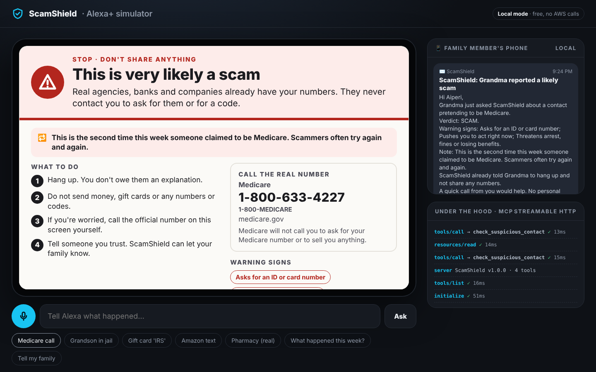
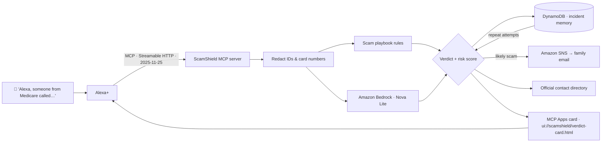

# 🛡️ ScamShield — a family fraud firewall for Alexa+

> *"Alexa, a man from Medicare just called and wants my card number."*
>
> ScamShield checks the story against known scam playbooks, shows a big, calm **red / yellow / green** verdict on screen, gives the **real** number to call back, quietly **alerts a family member**, and **remembers**: when the same "Medicare" calls again tomorrow, Alexa already knows.

ScamShield is a self-hosted **MCP server** (Model Context Protocol, spec **2025-11-25**, **Streamable HTTP**) built for **Alexa+**, with an **MCP Apps** verdict card for Echo Show screens and an **AWS** backend (Amazon Bedrock, DynamoDB, SNS).

**Hackathon entry:** Build, Ship, Shape — Amazon Developer Hackathon
**Primary track:** Alexa+ (self-hosted MCP server) · **Mini challenge:** AWS Builder



---

## Why

Fraud losses reported to the FTC by adults 60 and over rose from about **$600 million in 2020 to $2.4 billion in 2024** ([FTC, Dec 2025](https://www.ftc.gov/news-events/news/press-releases/2025/12/ftc-issues-annual-report-congress-agencys-actions-protect-older-adults)), and the losses are often life savings. The scripts are well known (fake Medicare, "your grandson is in jail," IRS gift cards, tech-support viruses), yet in the moment, alone, under pressure, they work.

The moment of doubt is exactly when someone might say *"Alexa, is this real?"* ScamShield turns that moment into protection:

| The scammer's tactic | What ScamShield does |
|---|---|
| Rush you | Calmly says **stop**, with 3–4 simple steps |
| Isolate you ("don't tell anyone") | **Alerts family** automatically on a likely scam |
| Give you a fake call-back number | Shows the **verified official number** instead |
| Try again tomorrow | **Remembers** the pattern across sessions and says so |
| Ask for your numbers | **Redacts** any ID/card numbers before analysis or storage |

## How it works



1. **Redact first.** SSNs, card/account numbers, Medicare IDs and emails are replaced with tags before anything reaches a model, a database or an alert.
2. **Hybrid analysis.** A deterministic, explainable **scam playbook** (15 scam tactics + 5 supporting signals that only count in combination, so "my grandson visited" is never flagged) always runs. When AWS is on, **Amazon Bedrock** (Converse API, Nova Lite by default) gives a second opinion; ScamShield keeps the **higher** risk, because for a safety tool a false alarm is far cheaper than a missed scam.
3. **Memory.** Incidents are stored per household in **DynamoDB** (180-day TTL). A repeat of the same impersonation raises the risk and Alexa says *"This is the third time this week someone claimed to be Medicare."*
4. **Agentic action.** On a likely scam, ScamShield **publishes an alert to SNS** (email to the trusted family member) without being asked. No personal numbers are ever included.
5. **Visual + voice.** Each tool result carries a `spoken` sentence for Alexa's voice and `structuredContent` for the **MCP Apps** card (large print, one action per row, high contrast, dark-mode aware). The card's **"Tell my family"** button calls a server tool back through the host.

## MCP tools

| Tool | What it does | AWS |
|---|---|---|
| `check_suspicious_contact` | Redact → analyze → remember → detect repeats → official contact → auto-alert family. Returns the verdict card. | Bedrock, DynamoDB, SNS |
| `get_official_contact` | Verified phone/website for Medicare, SSA, IRS, banks, Amazon, tech support, USPS, police, FTC, AARP helpline | — |
| `alert_trusted_family` | Manually let the trusted family member know | SNS |
| `get_incident_history` | "What suspicious calls did I get this week?" (also shown as a card) | DynamoDB |

**Resource:** `ui://scamshield/verdict-card.html` (`text/html;profile=mcp-app`), linked from tools via `_meta.ui.resourceUri`.
Server `instructions` tell the Alexa+ model when to call each tool and never to ask the user to repeat ID numbers.

## Quick start (free, no AWS needed)

Requires Node.js 22+.

```bash
npm install
npm run dev          # http://127.0.0.1:3000
```

- **Alexa+ simulator:** open http://127.0.0.1:3000 — speak (mic button, Chrome) or click a scenario. The Echo Show–style screen renders the real MCP Apps card; the right side shows the family member's phone and the live MCP calls.
- **MCP endpoint:** `http://127.0.0.1:3000/mcp` — try it with `npm run inspector` (MCP Inspector), transport *Streamable HTTP*.

In local mode the analysis uses the playbook, memory is in-process, and family alerts go to a local outbox shown in the simulator. Nothing costs money.

## Turn on AWS (Bedrock + DynamoDB + SNS)

1. Use an AWS account on the **Free plan** (credits, no surprise charges) and configure credentials (`aws configure`).
2. In the Bedrock console, enable **Amazon Nova Lite** in your region (or set `BEDROCK_MODEL_ID`).
3. Create the table and alert topic:
   ```bash
   ./infra/setup-aws.sh family.member@example.com
   ```
   Confirm the subscription email AWS sends.
4. `cp .env.example .env`, paste the printed values, set `SCAMSHIELD_AWS=1`, and run `npm run dev`.

The simulator header switches to **AWS mode**, and alerts arrive by email. If any AWS call fails, ScamShield **falls back** to the local path, so a demo never dies on stage.

Typical demo usage costs cents in Bedrock calls; DynamoDB on-demand and SNS email at this scale fall within free allowances.

## Connect to Alexa+

ScamShield is a standard remote MCP server (Streamable HTTP, spec 2025-11-25):

1. Deploy it behind HTTPS: the included `Dockerfile` runs on **AWS App Runner** or ECS/Fargate; for testing, a tunnel to `npm run dev` works.
2. Set `HOST=0.0.0.0`, `ALLOWED_HOSTS=<your domain>` and `SCAMSHIELD_API_KEY=<secret>` (clients send `Authorization: Bearer <secret>`).
3. Register `https://<your-domain>/mcp` with Alexa+ following the Alexa+ MCP onboarding in the hackathon resources.

The browser simulator is for local demos; leave `SCAMSHIELD_API_KEY` unset when running it.

The server is **stateless** (a fresh MCP server per request), so it scales horizontally; household memory lives in DynamoDB.

## Security & privacy by design

- **Data minimization:** redaction runs before Bedrock, DynamoDB, logs or alerts. Only redacted text is stored, and records expire after 180 days.
- **No numbers in alerts:** family emails contain the verdict and warning signs, never IDs.
- **Endpoint hardening:** optional bearer-token auth (constant-time compare), DNS-rebinding protection via the MCP SDK's host validation, JSON-only stateless transport.
- **Fail safe:** every AWS dependency has a local fallback; the higher of the two risk scores wins.
- **Verified contacts only:** ScamShield never repeats a number supplied by the caller.

## Tests

```bash
npm test
```

96 tests: redaction, playbook verdicts, conversational speech, the Bedrock merge logic (mocked), an end-to-end suite that talks to the real server over Streamable HTTP with the official MCP client (protocol negotiation, tool list, UI resource, repeat detection, privacy), and a detection benchmark.

### Detection benchmark

`test/benchmark.test.ts` holds **46 real-world scam scripts and 30 ordinary messages** (toll and package texts, "safe account" bank scams, romance scams, fake renewals, door-to-door cash, grandparent scams from a "new number", plus everyday messages like "my grandson visited today" or "the pharmacy says my refill is ready"). The offline rules flag every scam and raise no false alarms on this set.

To keep ourselves honest: the rules were tuned while the set was being built. On the last batch, written after tuning and checked before any further changes, the offline rules scored **16/18 with zero false alarms**. Keyword rules will always miss some brand-new wording, which is why AWS mode adds Amazon Bedrock as a second opinion.

## Project structure

```
src/
  server.ts            Express + Streamable HTTP transport (stateless), demo routes
  mcp.ts               MCP server: 4 tools, MCP Apps UI resource, instructions
  analyzer/            redact → rules (scam playbook) + Bedrock → merged verdict
  contacts.ts          verified official contact directory
  store.ts             incident memory: DynamoDB with in-memory fallback
  notify.ts            family alerts: SNS with local-outbox fallback
  ui/verdict-card.html MCP Apps view (large-print verdict card)
public/index.html      Alexa+ simulator (Echo Show–style host + MCP Apps bridge)
infra/setup-aws.sh     DynamoDB table + SNS topic setup
test/                  unit + end-to-end tests
docs/                  submission text, product feedback, friction log, video script
```

## What's next

- Echo Show **proactive** check-ins: a gentle "Did anyone call about money today?" after a flagged week.
- A **caregiver dashboard** (Alexa+ for the family member) built on `get_incident_history`.
- **Crowd-sourced playbook** updates from FTC alerts, so new scripts are caught within days.
- Ring integration: flag door-to-door "utility worker" scams with the same verdict card.

## License

MIT © 2026 Aiperi Moldobaeva. Not affiliated with Medicare, SSA, IRS or any organization listed in the contact directory; numbers are from official sources and should be re-verified before production use.
